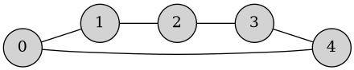
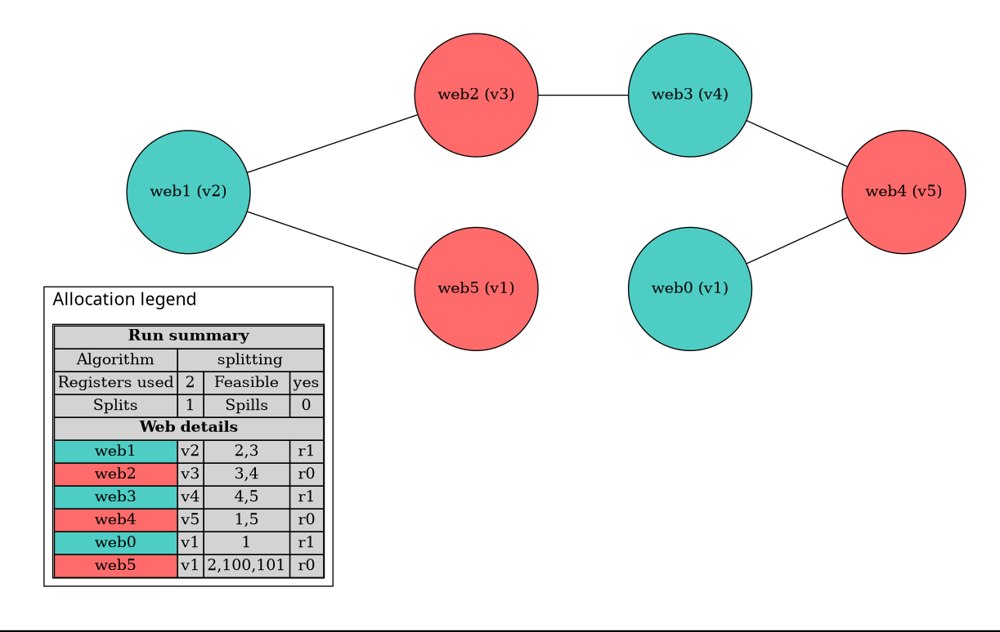

# Register Allocation via Graph Coloring

This project implements a high-performance **Global Register Allocator** using graph coloring heuristics. It transforms variable live ranges into an interference graph and provides four distinct allocation strategies to optimize register utilization and minimize memory traffic.

## Contributors:

- Rodrigo Fernandes Teixeira (up202404802@up.pt)
- Viacheslav-Illia Detsyk (up202412740@up.pt)
- Tomás Ferreira (up202305823@up.pt)

## Usage

### Batch Mode
```bash
./myProg -b <ranges_file> <config_file> <output_file>
```

### Interactive Mode
```bash
./myProg
```
Follow the on-screen menu to load data, choose algorithms, and run the allocation.

## Testing and Validation

The project includes a comprehensive automated test suite to ensure the technical integrity and output correctness of all allocation algorithms.

### Running the Tests
You can execute the test suite using the provided script:
```bash
./tests/run_tests.sh all        # Run the full suite (88 test cases)
./tests/run_tests.sh smoke      # Run only error-handling/smoke tests
./tests/run_tests.sh free       # Run only Free algorithm tests
./tests/run_tests.sh ranges     # Run all ranges against all algorithms
```

### Validation Criteria
A test is marked as **Passed** only if it satisfies the following structural requirements:
1.  **Zero-Crash Execution:** The program must exit with code `0`.
2.  **Artifact Generation:** The script verifies the creation of the report (`.txt`), the interference graph (`.gv`), and the allocated graph (`_allocated.gv`).
3.  **Format Compliance:** The output text is scanned via `grep` to ensure it strictly follows the project specification (e.g., `webs: N`, `registers: N`, and `rX/M: webY` assignments).
4.  **Graph Validity:** DOT files are checked for valid Graphviz headers to ensure visualization compatibility.

---

## Allocation Architectures

### 1. Basic Allocator
A strictly greedy approach. It removes nodes with degree $< N$ from the graph. If it encounters a state where all remaining nodes have degree $\geq N$, it terminates as unfeasible.

### 2. Spilling Allocator
A reliable allocator that resolves conflicts by moving variables to memory.
*   **Victim Selection:** Chooses the node with the **Highest Degree** to maximize graph simplification.
*   **Tie-breaker:** Prefers nodes with the **Smallest Footprint** (least definitions and uses) to minimize memory access overhead.

### 3. Splitting Allocator (Intelligent Structural Optimization)
An advanced alternative to spilling that fragments live ranges to break interferences.
*   **Exhaustive Search:** Unlike standard mid-point splitters, this implementation uses a **Brute-Force Simulation**.
*   **Logic:** It identifies the highest-degree node (with at least 2 lines) and simulates a split at **every possible program point** within its range.
*   **Evaluation:** For every potential split, it rebuilds a temporary interference graph and runs a simplification pass to count "stuck" nodes (those that would still force a spill). 
*   **Selection:** It chooses the exact split point that results in the **best colorability** (minimum number of stuck nodes). This surgically breaks cycles and high-pressure cliques without immediately resorting to memory.

### 4. Free (Hybrid) Allocator
The most sophisticated tier, combining global analysis with high-end heuristics. It follows a prioritized decision tree:
1.  **Clique Detection (Fail-Fast):** Detects $N+1$ variable cliques immediately. If found, it skips useless splits and performs an immediate spill.
2.  **DSATUR Coloring:** Uses the **Degree of Saturation** algorithm. It prioritizes nodes based on neighbor constraints, finding optimal colorings for dense graphs where greedy ordering fails.
3.  **Advanced Splitting Fallback:** Triggers the exhaustive simulation splitter if coloring fails.
4.  **Surgical Spill:** Performs a targeted spill if the split budget is exhausted.

---

## Complexity Summary

The performance of each allocator is determined by the number of variables ($W$), the length of live ranges ($L$), and the total number of interferences ($E$).

| Algorithm | Complexity | Strategy | Best Used For |
| :--- | :--- | :--- | :--- |
| **Basic** | $O(W^2 \cdot L \log L + E)$ | Simple Greedy | Low-pressure, linear code |
| **Spilling** | $O(W^2 \cdot L \log L + W^2 + E)$ | Degree-based Spill | Reliable general-purpose allocation |
| **Splitting** | $O(S \cdot L^2 W^2 \log L)$ | Brute-Force Simulation | Breaking complex interference cycles |
| **Free** | $O(C \cdot W^3 + S_{limit} \cdot L^2 W^2 \log L)$ | Hybrid Decision Tree | Maximum register utilization |

### Core Heuristic & Utility Complexity

| Function | Complexity | Description |
| :--- | :--- | :--- |
| `interferesWith` | $O(L \log L)$ | Intersection check using `std::set` binary search. |
| `rebuildAdjacency` | $O(W^2 \cdot L \log L)$ | Full graph reconstruction from scratch. |
| `findGreedyClique` | $O(W^3)$ | Heuristic clique finder to detect uncolorable bottlenecks. |
| `colorNodesDSATUR` | $O(W^3)$ | Saturation-based vertex coloring for dense graphs. |
| `evaluateColorability` | $O(W^2 \cdot L \log L + W^3)$ | Simulation of graph construction and simplification. |
| `buildWebs` | $O(R^2 \cdot L \log L)$ | Initial merging of overlapping LiveRanges ($R$). |

> For a detailed phase-by-phase breakdown and heuristic justifications, see [ALLOCATORS.md](./ALLOCATORS.md).

### Visual Examples (5-Cycle Case)

Below is a demonstration of how the **Splitting Allocator** resolves an uncolorable 5-cycle graph ($N=2$) by surgically breaking a live range.

#### 1. Initial Interference Graph
The original graph forms a pentagon (cycle of 5 nodes). With only 2 registers, this structure is uncolorable.



#### 2. Allocated Graph (After Splitting)
The allocator splits **Web 0** into two fragments (**Web 0** and **Web 5**), breaking the cycle and allowing a feasible 2-register allocation.



---

## Technical Details

Full API reference is available via [Doxygen Documentation](./docs/html/index.html) (run `doxygen docs/Doxyfile` to generate).

---

## Additional Range Files

The project includes several additional range files for testing specific allocator behaviors:

| File | Purpose |
|------|---------|
| `ranges_cycle_split.txt` | **5-Cycle Split Case:** A pentagon interference graph (odd cycle) that requires 3 colors. With N=2, splitting can break the cycle by splitting one node, reducing the chromatic number to 2. |
| `ranges_pres1_dsatur.txt` | **Star Graph (DSATUR Superiority):** Center node v0 connects to 5 leaf nodes. Greedy coloring may fail if leaves are colored first, but DSATUR colors the center first (highest saturation), demonstrating its advantage over simple greedy ordering. |
| `ranges_pres2_split.txt` | **Surgical Split (Hybrid Resolution):** A `long_var` bridges two independent computation regions. Free allocator splits `long_var` at the natural gap between the two regions, removing the artificial conflict without spilling. |
| `ranges_pres3_clique.txt` | **Point Clique (Fail-Fast Detection):** Four variables share line 5, forming a K4 clique. With 3 registers, Free allocator's greedy clique finder detects the bottleneck instantly and spills directly — bypassing DSATUR entirely. |
| `ranges_split_win.txt` | **Split Win Case:** A bridge variable spans two regions — a high-pressure region (3 variables, 2 registers) and a low-pressure region (2 variables, 2 registers). Splitting the bridge at the boundary resolves both regions independently. |
| `ranges7.txt` | **Stress Test (K10 Clique):** A dense interference graph with 10 variables that all overlap at a single point (line 1000). Designed to stress the allocator's ability to handle high register pressure and force spills/splits when N < 10. |
| `ranges8.txt` | **Congestion Test (Local Pressure):** A complex set of overlapping ranges with specific "congestion points" (lines 6, 8, 9). Used to verify how heuristics like DSATUR and Exhaustive Splitting handle localized interference clusters. |
